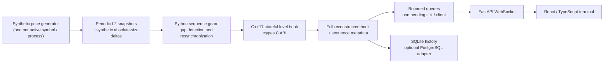

# MarketStream

**Full-stack simulated market-data terminal | React · TypeScript · FastAPI · WebSockets · C++17 · SQLite / optional PostgreSQL · Docker**

[Live demonstration](https://marketstream-sim-olabs123.onrender.com) · [CI workflows](https://github.com/olabs123-hue/-MarketStream/actions) · [In-process benchmark](https://github.com/olabs123-hue/-MarketStream/actions/runs/45190849808)

MarketStream is an educational real-time systems project. It produces **fictional BTC-USD, ETH-USD and SOL-USD prices**, synthesizes order-book depth, validates order-book state through a native C++17 engine, and displays the results in a responsive React dashboard. **It is not a trading platform, is not connected to an exchange, and provides no financial advice.**

## Architecture



### What it demonstrates

- **Stateful native engine:** Bid/ask price-level insertion, absolute-quantity updates, zero-quantity deletion, crossed-book rejection, bounded levels and top-of-book verification. The engine is written in C++17 and accessed via a native shared-library interface.
- **Sequence-aware simulated protocol:** Full snapshots at stream start and every 30 generated ticks; intermediate synthetic updates are validated as deltas. Duplicate or out-of-order events are rejected. A missing delta requires a newer full snapshot to resynchronize.
- **Shared WebSocket fanout:** One generator per active symbol in each Python process. Each subscriber gets a size-one queue; slow subscribers may miss intermediate observations. Configurable admission limits (default 60 total connections / 30 per symbol per process) and a five-second stalled-send timeout.
- **Operational visibility:** `GET /api/stream-status` reports subscriber counts, active symbols, generated ticks, dropped queued updates and producer failures. Counters are ephemeral process-local diagnostics.
- **Bounded observation history:** Last 500 generated observations per symbol in local SQLite by default. Optional PostgreSQL adapter and read-only cursor pagination for retained observations.
- **React dashboard:** Simulated live price chart, synthetic depth, spread, active native processor and level/sequence diagnostics, reconnecting WebSocket client.

## Run locally

Prerequisites: Python 3.12+, Node.js 22+, npm and (for native integration) a C++17 compiler.

```bash
python -m pip install -r backend/requirements.txt pytest httpx
python -m pytest -q tests
uvicorn backend.app:app --host 127.0.0.1 --port 8000
```

In a second terminal:

```bash
cd frontend
npm install
echo 'VITE_WS_URL=ws://localhost:8000' > .env.local
npm run dev
```

Without a compiled shared library, the backend uses its explicitly labeled `python-stateful-fallback`. To test native mode on Linux:

```bash
g++ -std=c++17 -O2 -fPIC -shared -Wall -Wextra -Werror engine/book_native.cpp engine/book_stateful.cpp -o engine/libmarketbook.so
MARKETSTREAM_REQUIRE_NATIVE=1 python -m pytest -q tests
```

### Docker

```bash
docker build -t marketstream .
docker run --rm -p 8000:8000 marketstream
```

Open `http://localhost:8000`. The image builds and requires the native C++ shared library. No exchange credentials, paid services or external market-data keys are required.

## Read-only API

| Endpoint | Purpose |
| --- | --- |
| `GET /health` | Lightweight process-health response and simulation mode |
| `GET /api/markets` | Supported synthetic symbols |
| `GET /api/history/{symbol}` | Deterministic **generated example** price path |
| `GET /api/recorded/{symbol}?limit=60` | Recently stored synthetic observations |
| `GET /api/replay/{symbol}?after_id=0&limit=100` | Cursor-ordered replay of retained observations |
| `GET /api/stream-status` | Per-process streaming diagnostics and connection limits |
| `WS /ws/{symbol}` | Reconstructed synthetic price/book stream with sequence metadata |

The WebSocket sends complete reconstructed book snapshots for compatibility with the frontend, even when `event_type` describes an internally processed delta. It cannot place orders or transfer funds.

## Verification and repeatable tests

GitHub Actions runs:

1. Python API, WebSocket, queue limits, sequence validation, stress and failure-recovery tests.
2. The same Python tests with the compiled C++ shared library required.
3. C++17 standalone correctness and stateful-level-book tests.
4. React TypeScript production build.
5. Multi-stage Docker build.
6. PostgreSQL storage-contract tests against an ephemeral PostgreSQL 16 GitHub Actions service.
7. An independently scoped in-process fanout benchmark, with a downloadable JSON artifact.

The v1.0 correctness stress scenario applies **500 generated snapshots/deltas** and checks native-state parity and sequence consistency. It also injects a missing event to verify snapshot-based resynchronization.

### Measured benchmark evidence (not live throughput)

A [GitHub Actions benchmark run](https://github.com/olabs123-hue/-MarketStream/actions/runs/45190849808) on 23 November 2026 reported **138,388.83 calls/s** and **p95 7.493 µs** for `MarketHub.publish()` with **20 in-process subscriber queues**, **1,000 warm-up publishes** and **10,000 measured publishes** on a Python 3.12.16 Linux runner. This measures Python enqueue time only, **not** end-to-end WebSocket latency, confirmed consumer deliveries, database throughput or C++ matching performance. Its size-one queues discarded stale observations; these numbers must not be presented as real-time trading or exchange-processing performance. Rerun `python -m scripts.benchmark_fanout --subscribers 20 --ticks 10000 --warmup 1000` to obtain machine-specific results.

The independent C++ benchmark is in `benchmarks/level_book_bench.cpp`; its results are not equivalent to the Python fanout measurement.

## Hosting, costs and limitations

- The live service uses an **existing Render free-tier Docker service**. Cold starts may occur; its default SQLite storage is **ephemeral**. Nothing in this repository requires a paid Render service.
- `MARKETSTREAM_DATABASE_URL` optionally enables PostgreSQL if the operator supplies a separate database; no persistent hosted PostgreSQL is configured in the free deployment.
- Streams and metrics are **single-process**; there is no Redis/Kafka cross-instance fanout, durable message log, or guaranteed recovery of missing observations.
- The synthetic sequence protocol is **not** an exchange-native feed specification. Gap injection and recovery are tested, not intentionally simulated in the public feed.
- There are **no user accounts, trade execution, brokerage connections, settlement, P&L, investment signals, or real financial prices**.
- The size-one subscriber queue bounds in-process pending snapshots but is not a network-egress cap or production anti-abuse system.

## Roadmap beyond v1.0

Cross-instance message distribution, persistent PostgreSQL deployment when affordable, genuine end-to-end load tests under controlled conditions, structured event logs and advanced native-engine property tests.

---

**Portfolio framing:** An educational **full-stack, C++17 and distributed-systems simulation** with testable WebSocket fanout, native stateful order-book reconciliation, failure/recovery scenarios and explicitly scoped performance evidence.
