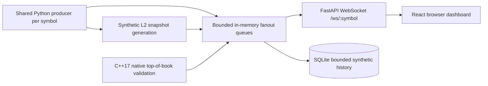

# MarketStream — Real-Time Market Data Simulation Terminal

**React · TypeScript · WebSockets · FastAPI · C++17 · Docker**

MarketStream is a **full-stack educational simulation** of a financial market-data terminal. It streams generated prices and synthetic order-book snapshots, with a responsive chart and symbol selector. **It does not connect to real exchanges, execute trades, or give investment advice.**

## Live demo status

**[Open the live simulated terminal](https://marketstream-sim-olabs123.onrender.com)** — hosted on Render's free tier. Docker and React production builds passed during initial deployment on 23 November 2026. All prices, volume levels, and changes are simulated. No external market-data subscription or API key is required.

## Features

- Shared single-process WebSocket producer per symbol, with one simulated tick per second, browser reconnect, and maximum-one pending snapshot per subscriber
- BTC-USD, ETH-USD and SOL-USD *simulated* feeds
- Live React/TypeScript price chart, top-of-book spread, and eight synthetic depth levels on each side
- Deterministic Python simulation helpers and independently tested REST endpoints
- Native C++17 order-book top-of-book validation in the Docker WebSocket feed, plus standalone C++ smoke tests
- Bounded SQLite history of generated simulation observations with a read-only endpoint
- Multi-stage Docker deployment and GitHub Actions test/build checks

## Architecture



Docker builds a C++17 shared library that validates the synthetic book's bid, ask and spread from the Python WebSocket path. Local development may use a Python fallback. SQLite retains only generated samples and is ephemeral on free hosting. No Kafka, Redis, or PostgreSQL are included.

## Quick start

Python 3.11+, Node.js 20+, npm.

Terminal 1:

```bash
pip install -r backend/requirements.txt
uvicorn backend.app:app --reload --port 8000
```

Terminal 2:

```bash
cd frontend
npm install
npm run dev
```

**Local development WebSockets:** Vite serves the UI at `http://localhost:5173` while FastAPI listens at `localhost:8000`. Set `VITE_WS_URL=ws://localhost:8000` in `frontend/.env.local` before starting Vite. Do not commit `.env.local`.

## Docker (frontend and API same origin)

```bash
docker build -t marketstream .
docker run --rm -p 8000:8000 marketstream
```

Open http://localhost:8000. No authentication or exchange key is needed because the feed is entirely fictional.

## API

- `GET /health` — status and simulation mode
- `GET /api/markets` — available simulated symbols and reference values
- `GET /api/history/{symbol}` — reproducible example prices
- `GET /api/recorded/{symbol}?limit=60` — latest generated observations in bounded SQLite history
- `WS /ws/{symbol}` — synthetic price and order-book snapshots; rejects invalid symbols

## Tests

```bash
pip install pytest httpx
python -m pytest -q tests
g++ -std=c++17 -Wall -Wextra -pedantic engine/order_book.cpp -o /tmp/orderbook && /tmp/orderbook
cd frontend && npm install && npm run build
```

## Limitations

This is a **portfolio MVP**. It has no live financial data, durable hosted persistence, Kafka integration, cross-instance pub/sub, durable message replay, client rate limiting, order matching, trade execution or service-level guarantees. Each running server process now creates a shared synthetic stream for each active symbol and broadcasts its ticks through size-one per-client queues. The Docker WebSocket path uses the C++ top-of-book validator; local development can fall back to Python. WebSocket messages are illustrative snapshots rather than market-grade level-2 incremental updates.

## Future roadmap

1. Extend the native C++ integration to stateful incremental order-book processing.
2. Add cross-instance fanout through a broker and explicit WebSocket session limits.
3. Replace ephemeral SQLite with PostgreSQL persistence and add deterministic replay.
4. Add benchmark evidence and failure-recovery tests.
5. Evaluate an authorized real-market-data adapter, clearly labeled and rate-limited.

## Native engine and bounded history

The deployed Docker image compiles `engine/book_native.cpp` as a shared library and sets `MARKETSTREAM_REQUIRE_NATIVE=1`. The Python stream calls it to validate best bid, best ask and spread. The local fallback is explicitly labeled in the `processor` message field. The standalone `engine/order_book.cpp` remains a separate educational example.

The `GET /api/recorded/{symbol}` endpoint returns up to 500 recent **generated** observations, stored in local SQLite (`MARKETSTREAM_DB`, default `/tmp/marketstream.sqlite3`). The store has a per-symbol retention limit of 500 and is **ephemeral on free hosting**. No exchange data, trading service, or order matching is provided.

### Validation

Backend tests: `python -m pytest -q tests`. Native mode: `g++ -std=c++17 -O2 -fPIC -shared -Wall -Wextra -Werror engine/book_native.cpp -o engine/libmarketbook.so && MARKETSTREAM_REQUIRE_NATIVE=1 python -m pytest -q tests`. Docker and frontend checks are in GitHub Actions; their status must be verified separately.

## Shared-stream fanout (v0.3)

- The first WebSocket subscriber starts one producer for its symbol inside that Python process. Later subscribers to the same symbol receive the same generated sequence instead of creating separate random walks.
- Each subscriber has a one-element asynchronous queue. If an older tick has not been consumed, the producer discards it and keeps the most recent tick. This bounds pending application-level queue memory; it does **not** cap networking-layer buffers or guarantee latency for indefinitely blocked sockets.
- Generated observations are written once per producer tick into ephemeral SQLite, not once per browser connection.
- Disconnecting the final client cancels that symbol's producer. FastAPI shutdown cancels all producers.
- **Single-process only:** Multiple Uvicorn workers or deployed instances each run separate simulated feeds. This is not Redis/Kafka fanout, and the history is not shared between instances.

Run `python -m pytest -q tests` for new shared-feed tests covering identical snapshots, one write per tick, bounded queues, invalid symbols and producer cleanup.


## v0.4 reliability improvements (single-process demo)

- **Connection admission limits:** By default at most 60 total WebSocket subscribers and 30 subscribers per symbol *per server process*. Excess connections receive WebSocket close code `1013`. Set `MARKETSTREAM_MAX_CLIENTS` and `MARKETSTREAM_MAX_PER_SYMBOL` (positive integers) to adjust the limits.
- **Stalled send timeout:** A WebSocket send that exceeds five seconds is dropped and its subscriber is removed. This protects the application handler from waiting indefinitely, but is not a substitute for reverse-proxy rate limiting, abuse protection or an egress quota.
- **Status endpoint:** `GET /api/stream-status` returns simulated mode, active symbol count and subscriber counts for the current process. No individual user identifiers are reported.
- **Regression coverage:** Unit tests for caps and queue cleanup, plus WebSocket admission tests.
- **Measured benchmark script:** `python -m scripts.benchmark_fanout --subscribers 20 --ticks 10000` measures only Python in-process queue publication. Its output is machine-specific and **cannot** be described as network throughput, end-to-end latency, or C++ engine throughput.

**Not yet implemented:** Cross-instance stream coordination, durable hosted PostgreSQL history, multi-instance replay, rate-limiting at the edge or production-grade access controls. Hosting remains free-tier simulated market data with ephemeral SQLite observations. No real market orders or transactions are possible.


## v0.4.1 failure recovery and operational counters

- Regression tests cover reconnect-after-disconnect, a simulated producer exception followed by a new subscription, multi-symbol shutdown, and queue-shedding counters.
- The hub catches producer exceptions, increments `producer_failures`, signals subscribers that the stream has stopped, and permits a fresh subscription to start a new generator. A new generator starts at sequence zero; **this is recovery, not continuity/replay**.
- `GET /api/stream-status` now also reports cumulative per-process `ticks_generated`, `queue_updates_dropped` and `producer_failures` counters for basic observability. These values reset on process restart and are **not** persistent SLA metrics.
- Existing in-process fanout benchmark can be run as `python -m scripts.benchmark_fanout --subscribers 20 --ticks 10000`. Results are not an end-to-end WebSocket benchmark.

All monitoring remains anonymous aggregate instrumentation for fictional market data. No login, real-market data or paid infrastructure was introduced.
