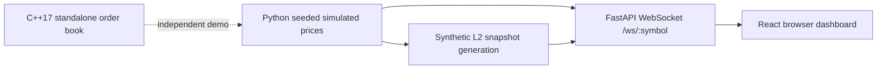

# MarketStream — Real-Time Market Data Simulation Terminal

**React · TypeScript · WebSockets · FastAPI · C++17 · Docker**

MarketStream is a **full-stack educational simulation** of a financial market-data terminal. It streams generated prices and synthetic order-book snapshots, with a responsive chart and symbol selector. **It does not connect to real exchanges, execute trades, or give investment advice.**

## Live demo status

Not deployed yet. All prices, volume levels, and changes are simulated. No external market-data subscription or API key is required.

## Features

- Real-time WebSocket stream at one tick per second, with automatic client reconnect
- BTC-USD, ETH-USD and SOL-USD *simulated* feeds
- Live React/TypeScript price chart, top-of-book spread, and eight synthetic depth levels on each side
- Deterministic Python simulation helpers and independently tested REST endpoints
- Standalone C++17 reference order-book implementation and smoke tests (**not integrated into the streaming backend**)
- Multi-stage Docker deployment and GitHub Actions test/build checks

## Architecture



The C++ module is an independent reference implementation, not a production matching engine or Python extension. No Kafka, Redis, or PostgreSQL are used in this MVP; these are future enhancements.

## Quick start

Python 3.11+, Node.js 20+, npm.

Terminal 1:

```bash
pip install -r backend/requirements.txt
uvicorn backend.app:app --reload --port 8000
```

Terminal 2:

```bash
cd frontend
npm install
npm run dev
```

**Local development WebSockets:** Vite serves the UI at `http://localhost:5173` while FastAPI listens at `localhost:8000`. Set `VITE_WS_URL=ws://localhost:8000` in `frontend/.env.local` before starting Vite. Do not commit `.env.local`.

## Docker (frontend and API same origin)

```bash
docker build -t marketstream .
docker run --rm -p 8000:8000 marketstream
```

Open http://localhost:8000. No authentication or exchange key is needed because the feed is entirely fictional.

## API

- `GET /health` — status and simulation mode
- `GET /api/markets` — available simulated symbols and reference values
- `GET /api/history/{symbol}` — reproducible example prices
- `WS /ws/{symbol}` — synthetic price and order-book snapshots; rejects invalid symbols

## Tests

```bash
pip install pytest httpx
python -m pytest -q tests
g++ -std=c++17 -Wall -Wextra -pedantic engine/order_book.cpp -o /tmp/orderbook && /tmp/orderbook
cd frontend && npm install && npm run build
```

## Limitations

This is a **portfolio MVP**. It has no live financial data, persistence, Kafka integration, production-grade multi-user fanout, backpressure handling, rate limiting, order matching, trade execution or service-level guarantees. The server creates an independent synthetic random walk per connected client. The standalone C++ module is not part of that WebSocket path. WebSocket messages are illustrative snapshots rather than market-grade level-2 incremental updates.

## Future roadmap

1. Integrate a C++ market-data processor behind a stable API contract.
2. Add bounded fanout and client backpressure policy.
3. Introduce PostgreSQL history and a replay endpoint.
4. Add benchmark evidence and failure-recovery tests.
5. Evaluate an authorized real-market-data adapter, clearly labeled and rate-limited.
