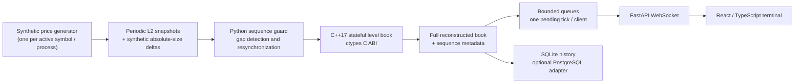

# MarketStream

**Full-stack simulated market-data terminal | React · TypeScript · FastAPI · WebSockets · C++17 · SQLite / optional PostgreSQL · Docker**

[Live demonstration](https://marketstream-sim-olabs123.onrender.com) · [CI workflows](https://github.com/olabs123-hue/MarketStream/actions) · [In-process benchmark](https://github.com/olabs123-hue/MarketStream/actions/runs/45190849808)

MarketStream is an educational real-time systems project. It produces **fictional BTC-USD, ETH-USD and SOL-USD prices**, synthesizes order-book depth, validates order-book state through a native C++17 engine, and displays the results in a responsive React dashboard. **It is not a trading platform, is not connected to an exchange, and provides no financial advice.**

## Verified measurement snapshot

| Experiment | Measured result |
| --- | --- |
| Python in-process fanout enqueue (20 subscriber queues, 10,000 measured publishes) | **138,388.83 calls/s**, p95 **7.493 µs** |
| Synthetic in-memory source failover | **200/200 successful switches**, p95 **2.964 µs** for local selection |

Evidence: [fanout CI benchmark](https://github.com/olabs123-hue/MarketStream/actions/runs/45190849808) · [synthetic failover CI benchmark](https://github.com/olabs123-hue/MarketStream/actions/runs/45196355759).

**Scope:** the fanout result measures Python enqueue operations, not C++ throughput, client WebSocket deliveries or end-to-end latency. The simulated failover figure excludes network activity and external vendors.

## Architecture



### What it demonstrates

- **Stateful native engine:** Bid/ask price-level insertion, absolute-quantity updates, zero-quantity deletion, crossed-book rejection, bounded levels and top-of-book verification. The engine is written in C++17 and accessed via a native shared-library interface.
- **Sequence-aware simulated protocol:** Full snapshots at stream start and every 30 generated ticks; intermediate synthetic updates are validated as deltas. Duplicate or out-of-order events are rejected. A missing delta requires a newer full snapshot to resynchronize.
- **Shared WebSocket fanout:** One generator per active symbol in each Python process. Each subscriber gets a size-one queue; slow subscribers may miss intermediate observations. Configurable admission limits (default 60 total connections / 30 per symbol per process) and a five-second stalled-send timeout.
- **Operational visibility:** `GET /api/stream-status` reports subscriber counts, active symbols, generated ticks, dropped queued updates and producer failures. Counters are ephemeral process-local diagnostics.
- **Bounded observation history:** Last 500 generated observations per symbol in local SQLite by default. Optional PostgreSQL adapter and read-only cursor pagination for retained observations.
- **React dashboard:** Simulated live price chart, synthetic depth, spread, active native processor and level/sequence diagnostics, reconnecting WebSocket client.

## Run locally

Prerequisites: Python 3.12+, Node.js 22+, npm and (for native integration) a C++17 compiler.

```bash
python -m pip install -r backend/requirements.txt pytest httpx
python -m pytest -q tests
uvicorn backend.app:app --host 127.0.0.1 --port 8000
```

In a second terminal:

```bash
cd frontend
npm install
echo 'VITE_WS_URL=ws://localhost:8000' > .env.local
npm run dev
```

Without a compiled shared library, the backend uses its explicitly labeled `python-stateful-fallback`. To test native mode on Linux:

```bash
g++ -std=c++17 -O2 -fPIC -shared -Wall -Wextra -Werror engine/book_native.cpp engine/book_stateful.cpp -o engine/libmarketbook.so
MARKETSTREAM_REQUIRE_NATIVE=1 python -m pytest -q tests
```

### Docker

```bash
docker build -t marketstream .
docker run --rm -p 8000:8000 marketstream
```

Open `http://localhost:8000`. The image builds and requires the native C++ shared library. No exchange credentials, paid services or external market-data keys are required.

## Read-only API

| Endpoint | Purpose |
| --- | --- |
| `GET /health` | Lightweight process-health response and simulation mode |
| `GET /api/markets` | Supported synthetic symbols |
| `GET /api/history/{symbol}` | Deterministic **generated example** price path |
| `GET /api/recorded/{symbol}?limit=60` | Recently stored synthetic observations |
| `GET /api/replay/{symbol}?after_id=0&limit=100` | Cursor-ordered replay of retained observations |
| `GET /api/stream-status` | Per-process streaming diagnostics and connection limits |
| `WS /ws/{symbol}` | Reconstructed synthetic price/book stream with sequence metadata |

The WebSocket sends complete reconstructed book snapshots for compatibility with the frontend, even when `event_type` describes an internally processed delta. It cannot place orders or transfer funds.

## Verification and repeatable tests

GitHub Actions runs:

1. Python API, WebSocket, queue limits, sequence validation, stress and failure-recovery tests.
2. The same Python tests with the compiled C++ shared library required.
3. C++17 standalone correctness and stateful-level-book tests.
4. React TypeScript production build.
5. Multi-stage Docker build.
6. PostgreSQL storage-contract tests against an ephemeral PostgreSQL 16 GitHub Actions service.
7. An independently scoped in-process fanout benchmark, with a downloadable JSON artifact.

The v1.0 correctness stress scenario applies **500 generated snapshots/deltas** and checks native-state parity and sequence consistency. It also injects a missing event to verify snapshot-based resynchronization.

### Measured benchmark evidence (not live throughput)

A [GitHub Actions benchmark run](https://github.com/olabs123-hue/MarketStream/actions/runs/45190849808) on 23 November 2026 reported **138,388.83 calls/s** and **p95 7.493 µs** for `MarketHub.publish()` with **20 in-process subscriber queues**, **1,000 warm-up publishes** and **10,000 measured publishes** on a Python 3.12.16 Linux runner. This measures Python enqueue time only, **not** end-to-end WebSocket latency, confirmed consumer deliveries, database throughput or C++ matching performance. Its size-one queues discarded stale observations; these numbers must not be presented as real-time trading or exchange-processing performance. Rerun `python -m scripts.benchmark_fanout --subscribers 20 --ticks 10000 --warmup 1000` to obtain machine-specific results.

The independent C++ benchmark is in `benchmarks/level_book_bench.cpp`; its results are not equivalent to the Python fanout measurement.

## Hosting, costs and limitations

- The live service uses an **existing Render free-tier Docker service**. Cold starts may occur; its default SQLite storage is **ephemeral**. Nothing in this repository requires a paid Render service.
- `MARKETSTREAM_DATABASE_URL` optionally enables PostgreSQL if the operator supplies a separate database; no persistent hosted PostgreSQL is configured in the free deployment.
- Streams and metrics are **single-process**; there is no Redis/Kafka cross-instance fanout, durable message log, or guaranteed recovery of missing observations.
- The synthetic sequence protocol is **not** an exchange-native feed specification. Gap injection and recovery are tested, not intentionally simulated in the public feed.
- There are **no user accounts, trade execution, brokerage connections, settlement, P&L, investment signals, or real financial prices**.
- The size-one subscriber queue bounds in-process pending snapshots but is not a network-egress cap or production anti-abuse system.

## Quote analytics and validation (v1.1)

This extension models the **data-validation and quote-analytics work** useful in financial-information engineering. It does not connect to external market-data providers.

- `backend/analytics.py` computes deterministic quote statistics from the already validated synthetic L2 book: **mid-price**, **bid–ask spread in basis points**, **best-level size-weighted microprice**, **total visible synthetic depth by side**, and **depth imbalance**.
- Prices are normalized to integer cents and sizes to integer thousandths, consistent with the C++ bridge. Invalid book depth, locked/crossed quotes, non-finite prices, negative sizes, duplicate or misordered levels are rejected.
- Analytics are attached **after** sequence validation and native C++ processing, preserving the existing synthetic full-snapshot/delta pipeline. The React terminal displays spread (bps), microprice and depth imbalance.
- `GET /api/analytics/{symbol}` returns only the most recent processed synthetic quote for **an actively subscribed symbol on this server process**. If nobody is subscribed, it returns `status: no_active_feed` and `analytics: null`. It is not an archival quote API.
- `tests/test_analytics.py` checks hand-calculated formula values, book-validation failures, live WebSocket vs REST consistency and native/fallback adapters.
- These are **descriptive analytics, not predictive trading signals**. No executions or actual trade prints exist, so claims such as VWAP, trade volume or real exchange performance would be unsupported.

Formula conventions: `spread_bps = 10000 × (best_ask − best_bid) / midpoint`; `imbalance = (sum_bid_size − sum_ask_size)/(sum_bid_size + sum_ask_size)`; `microprice = (best_ask × best_bid_size + best_bid × best_ask_size)/(best_bid_size + best_ask_size)`.

## Native sequencing migration — experimental component

A standalone C++17 `SequenceGuard` now lives in
[`engine/sequence_guard.hpp`](engine/sequence_guard.hpp), with a
[regression test](tests/sequence_guard_native_test.cpp) covering duplicate
rejection, gaps, snapshot-based resynchronization, and commit-after-book
state updates. The CI workflow compiles and executes this test: [MarketStream CI run 45631917300](https://github.com/olabs123-hue/MarketStream/actions/runs/45631917300) reports success for the **isolated native sequence guard** step, alongside the backend, native-integration, frontend, C++ and Docker steps. **The Python `SequencedBook` is still the active application path**; the native guard is not yet integrated into the live stream.

Integration, Python/native parity testing, native fanout, and measured
p50/p95/p99 C++ update latency are remaining tasks. Do not describe them
as delivered capabilities or add C++ sequencing benchmark numbers to the CV.

## Roadmap beyond v1.0

Cross-instance message distribution, persistent PostgreSQL deployment when affordable, genuine end-to-end load tests under controlled conditions, structured event logs and advanced native-engine property tests.

---

**Portfolio framing:** An educational **full-stack, C++17 and distributed-systems simulation** with testable WebSocket fanout, native stateful order-book reconciliation, failure/recovery scenarios and explicitly scoped performance evidence.


## v1.2 — Dual simulated feed normalization and source failover

MarketStream now includes a per-symbol `SourceRouter` with two **fictional** vendors:

- `SIM-A` supplies JSON-shaped quotes using `ticker`, `px` and `vendor_seq`.
- `SIM-B` supplies a deliberately different schema using `instrument` (slash-delimited), `last_price` (text), and `n`.
- Both formats are normalized and validated before the existing synthetic order-book, C++17 sequence engine and analytics stages. Source-local sequence identifiers are monotonic and duplicates or stale values are rejected per vendor.
- When the active simulated vendor is unavailable or emits an invalid event, the router attempts the backup **once**. If both fail, the producer stops and the existing WebSocket recovery behavior applies. The router does not automatically revert to the former primary.
- WebSocket events now include `source`, `source_sequence`, and `source_failover`; the dashboard displays these and `GET /api/stream-status` includes `source_failovers`. All counters and source states reset when the process or symbol stream restarts.

`tests/test_sources.py` exercises the two schemas, mismatched symbols, bad numbers, duplicate suppression, single-step failover and metadata in a real ASGI WebSocket test. No external data connections, network source probes or production-grade failover timing are claimed. The feeds remain **synthetic** and both are driven by the same simulated reference-price generator. This demonstrates schema adaptation and failover control flow rather than actual independently collected vendor data.


## v1.3 — Reliability, local source latency, and controlled fault injection

The synthetic SIM-A/SIM-B ingestion layer now measures the elapsed time spent **reading an in-memory fictional vendor object, normalizing its payload and selecting the active source** with `perf_counter_ns`. It exposes:

- Per-stream tick metadata `source_processing_us`, `source_attempts`, and `source_failover_us` (null when no switch occurred).
- `GET /api/stream-status` process-local cumulative `source_failovers`, `source_failed_attempts`, and bounded `source_latency_p95_us`, `source_failover_p95_us`, `source_latency_sample_count`. Percentiles are nearest-rank estimates from at most 512 observations (not long-term SLO metrics).
- Bounded `SourceRouter` samples of at most 256 source reads and 256 switches per producer, to avoid unbounded instrumentation growth.
- The React terminal displays current local source processing cost and, when applicable, the in-process failover cost.

### Controlled recovery test / benchmark

```bash
python -m scripts.benchmark_failover --events 2000 --fail-every 10 --output failover-evidence.json
```

This deterministic offline scenario repeatedly marks the **currently active fictional source** as failed, then verifies that the local backup is selected, and checks the number of successful failovers. It records p50/p95/p99 timings and machine metadata. GitHub Actions runs the scenario in `.github/workflows/failover-benchmark.yml` and preserves JSON evidence in an artifact. Regression tests cover rejection, two-source outage, bounded samples, live WebSocket metadata, and API metrics. **These are local synchronous Python timings only**; there are **no network outages, real exchange or external vendor feeds, WebSocket round trips or end-to-end recovery SLAs**. The production demo never intentionally triggers a vendor fault.

### Final verification and scope

GitHub Actions must pass backend, native C++ integration, frontend, standalone C++, Docker, PostgreSQL storage-contract, fanout benchmark, and fault-injection benchmark checks before deployment. Passing a test does not imply security accreditation or production-level robustness.

MarketStream remains a **portfolio-grade educational simulation**. The live Render free service uses ephemeral SQLite by default; optional hosted PostgreSQL is not provisioned. Its simulated vendor data is generated from a shared reference-price process, not independently sampled markets.


### Verified v1.3 fault-injection evidence

The [controlled failover workflow run](https://github.com/olabs123-hue/MarketStream/actions/runs/45196355759) on 23 November 2026 reported **200 / 200 successful simulated source switches**, with **p95 2.964 microseconds** for the synchronous in-memory failover selection; the sample window was the last 256 measurements on a GitHub-hosted Python 3.12.16 Linux runner. Source-read + normalization p95 was **2.414 microseconds** over the last 256 events. These figures **exclude all network activity**, C++ processing, database writes and WebSocket delivery. They are not real exchange-feed performance metrics, external vendor recovery time or an exchange latency claim.

The verified test scenario is reproducible through `python -m scripts.benchmark_failover --events 2000 --fail-every 10`. Download the workflow's `controlled-failover-evidence` artifact for exact measurements and run metadata.
