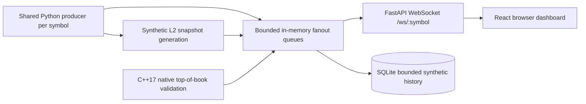

# MarketStream — Real-Time Market Data Simulation Terminal

**React · TypeScript · WebSockets · FastAPI · C++17 · Docker**

MarketStream is a **full-stack educational simulation** of a financial market-data terminal. It streams generated prices and synthetic order-book snapshots, with a responsive chart and symbol selector. **It does not connect to real exchanges, execute trades, or give investment advice.**

## Live demo status

**[Open the live simulated terminal](https://marketstream-sim-olabs123.onrender.com)** — hosted on Render's free tier. Docker and React production builds passed during initial deployment on 23 November 2026. All prices, volume levels, and changes are simulated. No external market-data subscription or API key is required.

## Features

- Shared single-process WebSocket producer per symbol, with one simulated tick per second, browser reconnect, and maximum-one pending snapshot per subscriber
- BTC-USD, ETH-USD and SOL-USD *simulated* feeds
- Live React/TypeScript price chart, top-of-book spread, and eight synthetic depth levels on each side
- Deterministic Python simulation helpers and independently tested REST endpoints
- Native C++17 order-book top-of-book validation in the Docker WebSocket feed, plus standalone C++ smoke tests
- Bounded SQLite history of generated simulation observations with a read-only endpoint
- Multi-stage Docker deployment and GitHub Actions test/build checks

## Architecture



Docker builds a C++17 shared library that validates the synthetic book's bid, ask and spread from the Python WebSocket path. Local development may use a Python fallback. SQLite retains only generated samples and is ephemeral on free hosting. No Kafka, Redis, or PostgreSQL are included.

## Quick start

Python 3.11+, Node.js 20+, npm.

Terminal 1:

```bash
pip install -r backend/requirements.txt
uvicorn backend.app:app --reload --port 8000
```

Terminal 2:

```bash
cd frontend
npm install
npm run dev
```

**Local development WebSockets:** Vite serves the UI at `http://localhost:5173` while FastAPI listens at `localhost:8000`. Set `VITE_WS_URL=ws://localhost:8000` in `frontend/.env.local` before starting Vite. Do not commit `.env.local`.

## Docker (frontend and API same origin)

```bash
docker build -t marketstream .
docker run --rm -p 8000:8000 marketstream
```

Open http://localhost:8000. No authentication or exchange key is needed because the feed is entirely fictional.

## API

- `GET /health` — status and simulation mode
- `GET /api/markets` — available simulated symbols and reference values
- `GET /api/history/{symbol}` — reproducible example prices
- `GET /api/recorded/{symbol}?limit=60` — latest generated observations in bounded SQLite history
- `WS /ws/{symbol}` — synthetic price and order-book snapshots; rejects invalid symbols

## Tests

```bash
pip install pytest httpx
python -m pytest -q tests
g++ -std=c++17 -Wall -Wextra -pedantic engine/order_book.cpp -o /tmp/orderbook && /tmp/orderbook
cd frontend && npm install && npm run build
```

## Limitations

This is a **portfolio MVP**. It has no live financial data, durable hosted persistence, Kafka integration, cross-instance pub/sub, durable message replay, client rate limiting, order matching, trade execution or service-level guarantees. Each running server process now creates a shared synthetic stream for each active symbol and broadcasts its ticks through size-one per-client queues. The Docker WebSocket path uses the C++ top-of-book validator; local development can fall back to Python. WebSocket messages are illustrative snapshots rather than market-grade level-2 incremental updates.

## Future roadmap

1. Add protocol-style incremental market-depth events with sequence-gap detection and resynchronization (current integration reconciles successive full synthetic snapshots).
2. Add cross-instance fanout through a broker and explicit WebSocket session limits.
3. Replace ephemeral SQLite with PostgreSQL persistence and add deterministic replay.
4. Add benchmark evidence and failure-recovery tests.
5. Evaluate an authorized real-market-data adapter, clearly labeled and rate-limited.

## Native engine and bounded history

The deployed Docker image compiles `engine/book_native.cpp` as a shared library and sets `MARKETSTREAM_REQUIRE_NATIVE=1`. The Python stream calls it to validate best bid, best ask and spread. The local fallback is explicitly labeled in the `processor` message field. The standalone `engine/order_book.cpp` remains a separate educational example.

The `GET /api/recorded/{symbol}` endpoint returns up to 500 recent **generated** observations, stored in local SQLite (`MARKETSTREAM_DB`, default `/tmp/marketstream.sqlite3`). The store has a per-symbol retention limit of 500 and is **ephemeral on free hosting**. No exchange data, trading service, or order matching is provided.

### Validation

Backend tests: `python -m pytest -q tests`. Native mode: `g++ -std=c++17 -O2 -fPIC -shared -Wall -Wextra -Werror engine/book_native.cpp -o engine/libmarketbook.so && MARKETSTREAM_REQUIRE_NATIVE=1 python -m pytest -q tests`. Docker and frontend checks are in GitHub Actions; their status must be verified separately.

## Shared-stream fanout (v0.3)

- The first WebSocket subscriber starts one producer for its symbol inside that Python process. Later subscribers to the same symbol receive the same generated sequence instead of creating separate random walks.
- Each subscriber has a one-element asynchronous queue. If an older tick has not been consumed, the producer discards it and keeps the most recent tick. This bounds pending application-level queue memory; it does **not** cap networking-layer buffers or guarantee latency for indefinitely blocked sockets.
- Generated observations are written once per producer tick into ephemeral SQLite, not once per browser connection.
- Disconnecting the final client cancels that symbol's producer. FastAPI shutdown cancels all producers.
- **Single-process only:** Multiple Uvicorn workers or deployed instances each run separate simulated feeds. This is not Redis/Kafka fanout, and the history is not shared between instances.

Run `python -m pytest -q tests` for new shared-feed tests covering identical snapshots, one write per tick, bounded queues, invalid symbols and producer cleanup.


## v0.4 reliability improvements (single-process demo)

- **Connection admission limits:** By default at most 60 total WebSocket subscribers and 30 subscribers per symbol *per server process*. Excess connections receive WebSocket close code `1013`. Set `MARKETSTREAM_MAX_CLIENTS` and `MARKETSTREAM_MAX_PER_SYMBOL` (positive integers) to adjust the limits.
- **Stalled send timeout:** A WebSocket send that exceeds five seconds is dropped and its subscriber is removed. This protects the application handler from waiting indefinitely, but is not a substitute for reverse-proxy rate limiting, abuse protection or an egress quota.
- **Status endpoint:** `GET /api/stream-status` returns simulated mode, active symbol count and subscriber counts for the current process. No individual user identifiers are reported.
- **Regression coverage:** Unit tests for caps and queue cleanup, plus WebSocket admission tests.
- **Measured benchmark script:** `python -m scripts.benchmark_fanout --subscribers 20 --ticks 10000` measures only Python in-process queue publication. Its output is machine-specific and **cannot** be described as network throughput, end-to-end latency, or C++ engine throughput.

**Not yet implemented:** Cross-instance stream coordination, durable hosted PostgreSQL history, multi-instance replay, rate-limiting at the edge or production-grade access controls. Hosting remains free-tier simulated market data with ephemeral SQLite observations. No real market orders or transactions are possible.


## v0.4.1 failure recovery and operational counters

- Regression tests cover reconnect-after-disconnect, a simulated producer exception followed by a new subscription, multi-symbol shutdown, and queue-shedding counters.
- The hub catches producer exceptions, increments `producer_failures`, signals subscribers that the stream has stopped, and permits a fresh subscription to start a new generator. A new generator starts at sequence zero; **this is recovery, not continuity/replay**.
- `GET /api/stream-status` now also reports cumulative per-process `ticks_generated`, `queue_updates_dropped` and `producer_failures` counters for basic observability. These values reset on process restart and are **not** persistent SLA metrics.
- Existing in-process fanout benchmark can be run as `python -m scripts.benchmark_fanout --subscribers 20 --ticks 10000`. Results are not an end-to-end WebSocket benchmark.

All monitoring remains anonymous aggregate instrumentation for fictional market data. No login, real-market data or paid infrastructure was introduced.


## v0.5 optional PostgreSQL and deterministic observation replay

- **Default demo stays free:** Without `MARKETSTREAM_DATABASE_URL`, history continues using local SQLite in `MARKETSTREAM_DB`. Render's free instance storage is ephemeral and may reset on replacement/restart.
- **Optional PostgreSQL:** Set `MARKETSTREAM_DATABASE_URL` to an externally provisioned PostgreSQL connection URL when durable storage is available. This is an opt-in backend adapter, not an active hosted PostgreSQL database. Do not commit credentials or put database connection strings in frontend environment variables.
- **Read-only cursor replay:** `GET /api/replay/{symbol}?after_id=0&limit=100` returns retained simulated observations in ascending database-ID order, a `next_after_id` cursor and `has_more` indicator (limit 1–500). Use the returned cursor for subsequent pages. This replays **stored observations**, not historical market trades or original live order-book state.
- **Bounded retention:** Both backends retain at most 500 observations per symbol by default; replay cannot retrieve deleted history. This is a portfolio-scale storage contract, not an archival system.
- **CI integration:** `.github/workflows/postgresql-history.yml` launches a temporary PostgreSQL 16 instance on GitHub Actions and runs the storage/replay contract tests. It does not create any cloud database or paid resource.

This version does **not** provide cross-instance fanout, historical order-book reconstruction, exactly-once processing, or persistent Render storage unless a PostgreSQL service is explicitly configured. Existing simulated WebSocket endpoints and React chart remain unchanged.


## v0.6 repeatable performance evidence

This release adds `scripts/benchmark_fanout.py` with repeatable warm-up, per-`publish()` wall-clock timing, nearest-rank p50/p95/p99 latency, queue-shedding count, Python version, and execution platform. The `.github/workflows/benchmark.yml` CI workflow runs the benchmark (20 subscribers; 10,000 measured publishes, 1,000 warm-up publishes) and attaches a **JSON artifact** to each GitHub Actions run. Run it locally:

```bash
python -m scripts.benchmark_fanout --subscribers 20 --ticks 10000 --warmup 1000 --output fanout-benchmark.json
```

**Scope:** Python in-process delivery to `asyncio.Queue(maxsize=1)` only. It excludes WebSocket serialization/network transmission, database recording, native C++ processing, exchange ingestion, and end-to-end response latency. The offered updates can replace previous updates in each subscriber's size-one queue; `attempted_queue_deliveries` is not confirmed consumer delivery. Compare results only with the same workload and environment; do not market these figures as financial trading latency.

Additional tests validate the benchmark's reporting consistency and use multiple ASGI WebSocket clients to exercise the shared per-symbol producer. Restart and injected-failure recovery tests from v0.4.1 remain part of the backend test suite. No production load testing against the live free Render service is performed.


## v0.7 stateful C++17 level-book engine

A **separate native C++17 component** now supports incremental L2 price-level operations via `engine/level_book.hpp`:

- Bid/ask level insertion and replacement using integer-cent prices and absolute synthetic quantities.
- Zero-quantity level deletion, best-bid/best-ask/spread calculation, bounded levels per side, invalid-input rejection and non-crossing book invariants.
- Dedicated native correctness cases in `tests/level_book_test.cpp`, compiled and run by GitHub Actions.
- A separate single-threaded `std::map` replacement/top-of-book microbenchmark in `benchmarks/level_book_bench.cpp`, also checked in CI.

To test locally:

```bash
g++ -std=c++17 -O2 -Wall -Wextra -Werror -pedantic tests/level_book_test.cpp -o /tmp/level-book-test
/tmp/level-book-test
g++ -std=c++17 -O2 -Wall -Wextra -Werror -pedantic benchmarks/level_book_bench.cpp -o /tmp/level-book-bench
/tmp/level-book-bench 200000
```

**Integration boundary:** This stateful L2 engine is an independently tested reference component, **not yet wired into the live WebSocket feed**. The deployed feed still uses the existing C++ `ms_top_of_book` function to validate each synthetic snapshot. The new engine is not a trade matching engine, exchange feed handler, or production trading system. Native benchmark speed is *not* the latency of the WebSocket dashboard or transaction processing.


## v0.8 — Live C++17 stateful level-book integration

The *simulated* WebSocket producer now allocates an independent native C++17 book per active symbol. Each generated synthetic L2 snapshot is reconciled against the previous snapshot by deleting vanished price levels and inserting/replacing changed levels. The C++ C ABI validates unique positive price/quantity levels, rejects crossed books, and prepares updates off to the side so a rejected snapshot does not modify the accepted book.

The Python adapter `backend/stateful.py` verifies native best bid, best ask, spread, and level counts against the generated snapshot before broadcasting, and publishes `processor: "cpp17-stateful"`, `book_levels`, `level_updates`, and `book_mode: "snapshot-delta-reconciliation"` in WebSocket messages. Locally, a labeled Python reference fallback is used if the shared library is absent. Render requires the native library.

The native book lifetime is tied to the in-process symbol producer: when all subscribers disconnect or a producer fails, the book is closed; reconnecting starts a new simulated session at sequence zero. This is **full-snapshot-to-level-delta reconciliation**, not an exchange incremental feed decoder, an order-matching engine, or persistent order-book replay. Real exchange data and trading are not supported. Backend and native CI run the stateful book consistency tests.


## v0.9 — Sequence-aware simulated incremental depth

The simulated producer now generates **full synthetic snapshots at sequence 0 and every 30th tick**, and otherwise derives **absolute-quantity L2 price-level delta events** from successive snapshots. `backend/sequencing.py` validates monotonically increasing sequences and reconstructs a full book for the existing React dashboard. The C++17 stateful book remains responsible for accepting or rejecting the resulting book and reconciling price levels. WebSocket messages include `event_type` (`snapshot` or `delta`), `resynchronized`, and `sequence_gaps_detected`.

- Duplicate or out-of-order updates are rejected, with no accepted-book mutation.
- A missing delta marks the stream as requiring a fresh full snapshot. Further deltas are rejected until the snapshot restores consistency.
- A valid newer full snapshot can resynchronize the stream, and accepted snapshots are validated against native best bid, ask, spread and depth counts.
- Snapshot-to-delta and recovery cases are covered in `tests/test_sequencing.py`, including native-library mode on GitHub Actions.
- The browser receives a **complete reconstructed book on every message**, even when the internal event is a delta, to preserve its chart and depth-table interface.

This is an educational synthetic protocol, **not** an exchange-native feed adapter. The current live producer generates consecutive events and does not intentionally inject packet loss; recovery behavior is exercised through tests. There is no cross-instance replay, exchange sequence numbering, real trading or production reliability guarantee.
